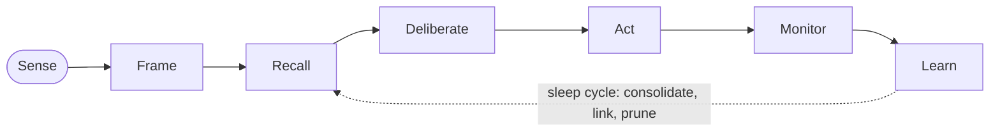
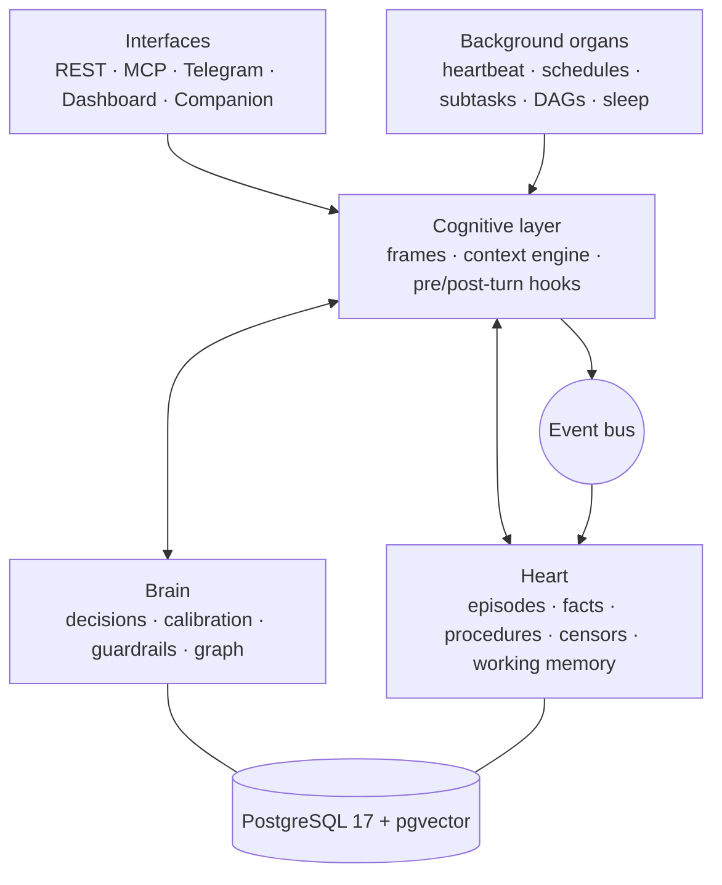

<p align="center">
  
</p>

<h1 align="center">Nous</h1>

<p align="center">
  <b>The AI agent that remembers, checks its own work, and gets better with use.</b><br>
  A cognitive architecture grounded in Marvin Minsky's <i>Society of Mind</i>.
</p>

<p align="center">
  
  
  
  
</p>

<p align="center">
  <a href="docs/quickstart.md"><b>Quickstart</b></a> ·
  <a href="#why-nous">Why Nous</a> ·
  <a href="#features">Features</a> ·
  <a href="#how-it-thinks">How it thinks</a> ·
  <a href="docs/features/INDEX.md">Feature index</a> ·
  <a href="CHANGELOG.md">Changelog</a>
</p>

> *"To explain the mind, we have to show how minds are built from mindless stuff."* — Marvin Minsky

Most agents are brilliant for one conversation and blank the next. Nous is built to live for months: one agent, one database, and a growing memory of what it saw, what it decided, what worked and what didn't. It works on its own schedule, carries long jobs in the background, and is held to account by records of what it actually did.

## Why Nous

| | Most agents and harnesses | Nous |
|---|---|---|
| **Lifetime** | One session, then the context resets | Always on, with months of history in one database |
| **Memory** | A chat log, a notes file or a vector store | Typed memories (episodes, facts, procedures, decisions, censors) linked in a knowledge graph and consolidated every night |
| **Decisions** | Made and forgotten | Recorded with confidence and reasons, reviewed against outcomes, calibrated over time |
| **"Done!"** | Taken on trust | Checked against a durable ledger of the tool calls that really ran |
| **Rules** | Prompt instructions it may ignore | Censors and guardrails that block the action in code |
| **Initiative** | Waits for your message | Heartbeat checks, schedules, background tasks and multi-step plans |
| **Getting better** | Only when you edit its prompt | Learns procedures from what worked; every new lesson must pass a gate first |
| **Grading** | Grades itself | Background work is scored by a separate, deterministic scorer |

Nous is not a wrapper around a chat window. It is the long-lived mind behind one.

## Features

<table>
<tr>
<td width="50%" valign="top">

### 🧠 Memory with structure
Episodes, facts, procedures, censors and working memory, each with its own lifecycle. Recall fuses full-text and vector search, then spreads through a knowledge graph. A nightly sleep cycle consolidates, links and prunes.

</td>
<td width="50%" valign="top">

### ⚖️ Decision intelligence
Every significant decision is recorded with its confidence, reasons and deliberation trace. Similar past decisions come back before the next choice; outcomes are reviewed and Brier scores track calibration.

</td>
</tr>
<tr>
<td valign="top">

### 📈 Learns from experience
Procedures (Minsky's K-lines) are learned from clusters of successful decisions, episode lessons and error recoveries. A lesson gate checks each one against its evidence and against what Nous already knows.

</td>
<td valign="top">

### 🧾 Honest execution
Side-effecting tool calls are recorded in a durable execution ledger. Risky actions are gated by tier, and after each turn the agent's claims are checked against what actually ran.

</td>
</tr>
<tr>
<td valign="top">

### 🫀 Works without being asked
A heartbeat runs scheduled checks (health, Drive, email, or any check described in plain words) and escalates what matters. Schedules, background subtasks and durable multi-node DAGs carry long work.

</td>
<td valign="top">

### 📏 Measured, not self-graded
Finished background subtasks get a deterministic score from a separate scorer job, built to run under its own database role so the agent can read its scores but not change them.

</td>
</tr>
<tr>
<td valign="top">

### 📱 Shows its work
A dashboard covers memory, the graph, decisions, calibration, retrieval, the ledger, the heartbeat and DAGs. A companion app (web and Android) lets the agent answer with live, interactive UI.

</td>
<td valign="top">

### 🔌 Meets you where you are
Streaming chat over REST, an MCP server for other agents and tools, and a streaming Telegram bot with attachments. Tools include web search, Python, a shell, files, documents and an optional browser.

</td>
</tr>
</table>

### Everything Nous can do

Capabilities that change behavior sit behind documented flags. Items marked *opt-in* ship switched off; see the [environment variable reference](docs/reference/environment-variables.md).

<details>
<summary><b>🧠 Memory: what gets kept</b></summary>

- **Episodes** — each conversation is summarized; its verbatim transcript can also be kept in chunks next to the summary *(opt-in)*.
- **Facts** — extracted from conversations, scored for admission, tagged as actionable or not, and superseded when newer facts contradict them. Date-anchored extraction for events is *opt-in*.
- **Corrections** — when you correct the agent, the correction becomes a stored principle.
- **Procedures and skills** — learned K-lines plus skills taught with `learn_skill` from a URL, a file or inline markdown, delivered in full when recalled.
- **Censors** — "don't do this" rules that block a matching action, created when the agent finds a failure mode.
- **Documents and attachments** — `ingest_document` chunks and stores whole documents; images, PDFs and text files arrive through Telegram and REST.
- **Working memory** — the state of the current task, with a timed cleanup.
- **Safe extraction** — conversation text reaches the extractor fenced off as data, not as instructions.
- **Dense documents** *(opt-in)* — enumerative extraction into atomic keyed facts, exact-key retrieval and exemplar-based recall for classification-style questions.

</details>

<details>
<summary><b>🔍 Recall and context</b></summary>

- **Hybrid search** — full-text and vector results fused by Reciprocal Rank Fusion, with a relevance floor and a staleness penalty.
- **Graph-augmented recall** — spreading activation across facts, decisions, episodes and procedures, with contradictions surfaced at recall time.
- **Re-ranking** *(opt-in)* — MMR diversity and a cross-encoder in `recall_deep`, plus multi-query expansion.
- **Context engine** — frame-adaptive, token-budgeted context assembly with deduplication and an anti-hallucination prompt.
- **Long sessions** — tool output compressed at ingestion with the full text one `cache_retrieve` away, four-tier pruning of old tool results, and history compaction with a hallucination guard.
- **Prompt caching** — a three-tier system prompt and a stable tool set keep most of each request cached.

</details>

<details>
<summary><b>🕸️ Knowledge graph and sleep</b></summary>

- **Cross-type graph** — typed edges between facts, decisions, episodes and procedures, created at write time and densified later. Linking transcript chunks into the graph is *opt-in*.
- **Sleep cycle** — consolidates and links memories, backfills orphans, re-links episodes, resolves contradictions, recovers abandoned conversations and cleans up dead edges.
- **Consolidation audit** *(opt-in)* — a reviewable changelog of what each sleep cycle changed.

</details>

<details>
<summary><b>⚖️ Decisions, calibration and self-monitoring</b></summary>

- **Pre-action protocol** — recall similar decisions, check guardrails, record intent before acting.
- **Decision records** — confidence, category, stakes, several independent reasons and a live deliberation trace.
- **Outcome review** — `resolve_decision` closes the loop; Brier scores and a calibration factor keep confidence honest.
- **Guardrails** — CEL rules that block risky decisions.
- **Critic** — a smart frame selector and diagnostic critics, plus a decision-quality rubric fed by outcome signals (letting the rubric evolve itself is *opt-in*).

</details>

<details>
<summary><b>📈 Learning and identity</b></summary>

- **K-line learning** — procedures from decision clusters, episode lessons and error recoveries, each passing a lesson gate that requires cited evidence and refuses a lesson an existing procedure already teaches.
- **Procedure lifecycle** — procedures track how well they work; weak or stale ones are reviewed and revised or retired.
- **Identity** — character, values and protocols stored in the database, with an initiation protocol. A user profile split into core facts and current intent is *opt-in*.

</details>

<details>
<summary><b>🧾 Execution integrity</b></summary>

- **Execution ledger** — a durable record of side-effecting tool calls. A background send refuses to run without its record; other calls go ahead with a logged warning if the ledger write fails. It can also keep each call's redacted command and output *(opt-in)*.
- **Action gating** — tools are classed by side effect, and write, external and irreversible actions pass tiered checks first.
- **Claim verification** — after each turn, what the agent says it did is checked against the ledger.
- **Censor middleware** — censors can run read-only checks before an action proceeds and unblock it when the check passes.
- **Guarded sends** — background sends are keyed, so a retry does not send a second copy, and `send_email` works only toward an allowlist.
- **Undo journal** — before-state snapshots of the files, schedules and checks the agent changes.
- **Approvals** *(opt-in)* — a plan step can wait for the owner's answer; a waiting plan is parked and resumes when the answer arrives.

</details>

<details>
<summary><b>🫀 Autonomy and orchestration</b></summary>

- **Heartbeat** — health, Google Drive, email *(opt-in)* and prompt-defined checks; findings are deduplicated, escalated and summed up in a daily digest. Self-tuning of check parameters from outcomes is *opt-in*.
- **Known false positives** — a rules file closes recurring false alarms at ingest, each rule with an expiry date ([format](docs/reference/heartbeat-known-false-positives.md)).
- **Fault detector** *(opt-in)* — flags faculties that fail silently: stalled sleep phases, collapsing change ratios, retrieval canaries.
- **Subtasks and schedules** — a background worker pool, cron and one-shot schedules, and inline subtasks.
- **DAG orchestration** — multi-node plans with at-least-once result delivery, node timeouts, a wall-clock reaper and token accounting. Stall detection and per-frame concurrency caps are *opt-in*.
- **Intentions and continuation** *(opt-in)* — every spawn records why it was started; when results arrive the agent follows up, and outward actions become proposals the owner approves.
- **Coding jobs** *(opt-in)* — from a shell held to an allowlist, the agent can launch Claude Code jobs in their own worktrees and follow their pull requests.

</details>

<details>
<summary><b>📏 Measurement and evaluation</b></summary>

- **Task scores** — one deterministic score per finished background subtask from a separate scorer job (cancelled ones are recorded as not scored; DAG runs and intention chains get count-only roll-ups), with an autonomy scoreboard on the dashboard.
- **Retrieval eval harness** — per-source relevance labels, paired A/B configurations and a persistent eval database.
- **Retrieval telemetry** — recalls are logged with drop attribution: what was found, and where each candidate was lost.

</details>

<details>
<summary><b>🛠️ Tools</b></summary>

- **Memory** — `record_decision`, `recall_deep`, `recall_recent`, `learn_fact`, `learn_skill`, `ingest_document`, `get_procedure`, `create_censor`, `cache_retrieve`.
- **Work** — `bash`, `read_file`, `write_file`, `run_python`, `send_file`.
- **Web** — `web_search` (routed by query type across Tavily, Exa and Brave), `web_fetch`, and `browser_task` *(opt-in)*, an isolated agent loop on headless Chromium.
- **Delegation** — `spawn_task`, `spawn_sync`, `schedule_task`, `dag_create`, `list_tasks`, `cancel_task`, `heartbeat_check_create`, `heartbeat_check_manage`.
- **Companion** — `push_surface` and `propose_action`.

The [agent tools reference](docs/reference/agent-tools.md) lists every tool and which frames can use it.

</details>

<details>
<summary><b>📱 Interfaces</b></summary>

- **REST API** — chat (plain and streaming), memory, decisions, identity, heartbeat, DAGs and dashboard routes ([reference](docs/reference/rest-api.md)).
- **MCP server** — `nous_chat`, `nous_recall`, `nous_status`, `nous_teach`, `nous_decide`.
- **Telegram** — a streaming bot with attachments and file delivery.
- **Dashboard** — a Svelte 5 app for memory, the graph, decisions and calibration, retrieval telemetry, consolidation, prompt-cache efficiency, the ledger, the heartbeat, DAGs, identity and autonomy.
- **Companion app** — the agent answers with interactive UI: approval gates, findings cards and self-built micro-apps with charts, metric cards and tables that refresh live. It installs as a web app, and a native Android beta adds push notifications.

</details>

## How it thinks

Every turn runs through the Nous loop, and a sleep cycle feeds what was learned back into recall:



- **Frame**: decide what kind of situation this is. The frame sets which memories, tools and models matter.
- **Recall**: rebuild the context this kind of work needs, within a token budget.
- **Deliberate**: check guardrails, recall similar past decisions, and record intent before acting.
- **Act**: call tools in a direct Anthropic API loop; side effects go into the execution ledger.
- **Monitor**: compare what was claimed with what actually ran.
- **Learn**: record outcomes, update calibration, extract facts and lessons.

## Architecture



- **One process, one database.** Brain and Heart are in-process Python modules sharing one connection pool: no network hop between the parts of the mind. Everything lives in one PostgreSQL database with pgvector, in four schemas: `brain`, `heart`, `nous_system` and `scoring`.
- **Multi-agent ready.** Every row is scoped by `agent_id`, so one database can host several agents.
- **Direct API.** Nous talks to the Anthropic API over httpx with its own tool-dispatch loop, and supports API keys and subscription tokens.
- **Async everywhere.** SQLAlchemy 2.0 with asyncpg, Starlette, pydantic v2.

## Built on the Society of Mind

| Minsky's idea | In Nous |
|---|---|
| **K-lines** | Procedures that rebuild the mental state a kind of work needs |
| **Censors** | Rules that block an action rather than rewrite it |
| **Frames** | One active interpretation per turn, switched explicitly |
| **Papert's principle** | Growth through better management of what is already known: detours, not replacements |
| **Parallel bundles** | Decisions backed by several independent reasons, not one chain |
| **B-brains** | A critic that watches the agent think (first phase shipped) |

## Quickstart

```bash
git clone https://github.com/tfatykhov/nous.git
cd nous
cp .env.example .env    # set ANTHROPIC_API_KEY; OPENAI_API_KEY enables embeddings
docker compose up -d
curl http://localhost:8000/health
```

Then say hello:

```bash
curl -X POST http://localhost:8000/chat \
  -H "Content-Type: application/json" \
  -d '{"message": "Hello, who are you?"}'
```

The dashboard is at `http://localhost:8000/dashboard`. Migrations run on startup. The [Quickstart guide](docs/quickstart.md) covers Telegram, local development and verification.

## Documentation

| | |
|---|---|
| [Quickstart](docs/quickstart.md) | Deploy from scratch, local development, verification |
| [Feature index](docs/features/INDEX.md) | Every feature and its status, including planned work |
| [What's shipped](docs/reference/shipped-features.md) | Ship notes, design rationale and invariants |
| [Environment variables](docs/reference/environment-variables.md) | Settings and feature flags |
| [REST API](docs/reference/rest-api.md) · [Agent tools](docs/reference/agent-tools.md) | The interfaces |
| [Project structure](docs/reference/project-structure.md) | A map of the code |
| [Research](docs/research/) | Design rationale, from the [Minsky mapping](docs/research/002-minsky-mapping.md) to [storage](docs/research/004-storage-architecture.md) |

## Relationship to Cognition Engines

Nous applies the decision-intelligence ideas proven by [Cognition Engines](https://github.com/tfatykhov/cognition-agent-decisions): decisions, deliberation traces, calibration, guardrails and bridge definitions. It is an independent implementation. Cognition Engines is a standalone server any agent can call; the Nous Brain is an embedded organ with no network overhead. **Same ideas, not same code.**

## License

[Apache 2.0](LICENSE)

## Acknowledgments

- **Marvin Minsky**, whose *Society of Mind* (1986) is the theoretical foundation
- **Cognition Engines**, which proved the decision-intelligence principles Nous applies
- Built with curiosity and too much coffee ☕
